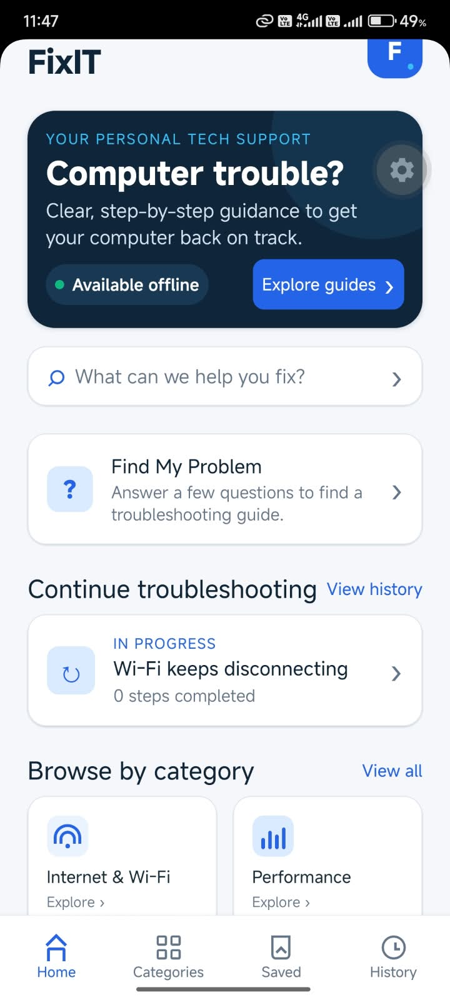
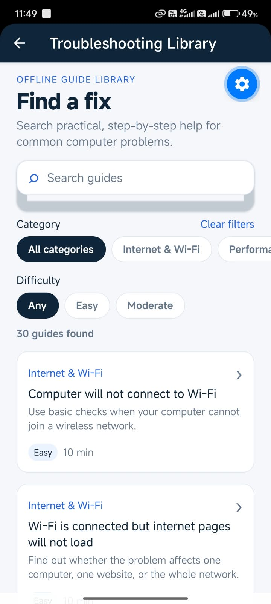
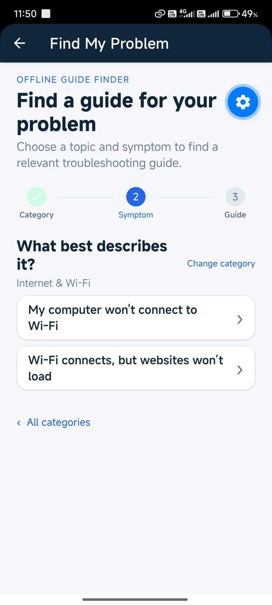
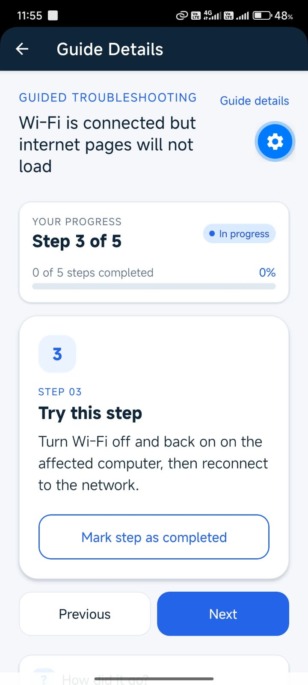
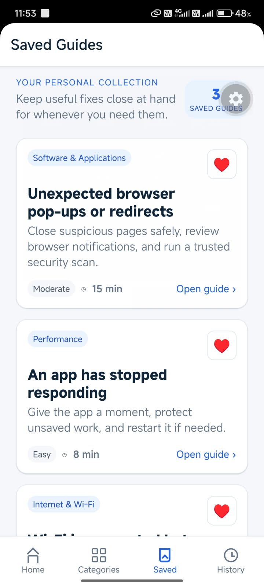
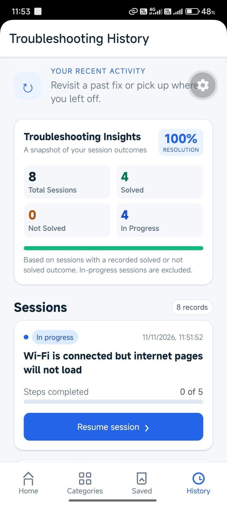

# FixIT — Offline Computer Troubleshooting Assistant

FixIT is an offline-first React Native application that helps people work through common computer problems using locally bundled, step-by-step guides. It is intended for users who want clear self-service guidance, including when an internet connection is unavailable.

The application includes 30 guides across six categories, interactive troubleshooting sessions, locally saved guides, session history, a rule-based symptom finder and a summary of recorded troubleshooting outcomes.

## Key features

- **Home dashboard:** shortcuts to the guide library, categories and Smart Diagnostic Wizard, plus a link to resume the most recently updated in-progress session.
- **Category browsing:** explore six topics and see how many bundled guides each contains.
- **Search and filters:** search guide titles and descriptions, then filter by category and difficulty.
- **Detailed guides:** review descriptions, possible causes, required tools, estimated time, step instructions and safety warnings when provided by the guide.
- **Interactive troubleshooting:** start or resume a session, move through the guide’s steps, mark steps complete and record whether the problem was solved.
- **Saved Guides:** save useful guides for later and remove them from the local collection.
- **Session history:** revisit past sessions and resume sessions that are still in progress.
- **Troubleshooting Insights:** view session totals by status and a resolution rate calculated from completed outcomes.
- **Smart Diagnostic Wizard:** select a category and symptom to receive a rule-based recommendation for an existing guide.

## App Screenshots

<table>
  <tr>
    <td align="center"><strong>Home Dashboard</strong><br></td>
    <td align="center"><strong>Guide Library</strong><br></td>
    <td align="center"><strong>Smart Diagnostic Wizard</strong><br></td>
  </tr>
  <tr>
    <td align="center"><strong>Interactive Troubleshooting</strong><br></td>
    <td align="center"><strong>Saved Guides</strong><br></td>
    <td align="center"><strong>Troubleshooting Insights</strong><br></td>
  </tr>
</table>

## Technology stack

| Technology | Project version |
| --- | --- |
| Expo SDK | 58 (`expo` `~58.0.22`) |
| React Native | `0.88.1` |
| React | `19.3.0` |
| React Navigation | Native `^7.5.1`, bottom tabs `^7.21.0`, native stack `^7.21.0` |
| Expo SQLite | `~58.0.15` |
| Local knowledge base | Bundled JSON files |

The project also uses `expo-status-bar`, `react-native-safe-area-context` and `react-native-screens`; their declared versions are in [package.json](package.json).

## Prerequisites and installation

- Node.js **22.13.x or newer**, meeting Expo SDK 58’s documented minimum ([Expo SDK reference](https://docs.expo.dev/versions/v58.0.0/)).
- npm, included with Node.js.
- For Android testing, either an Android phone with a compatible Expo Go app or an Android emulator configured on the development computer.
- Git to clone the repository.

Clone and install the locked dependencies:

```bash
git clone https://github.com/ManinduDeshan55/FixIT-Offline-Troubleshooting.git
cd FixIT-Offline-Troubleshooting
npm ci
npm start
```

When the Expo development server starts, open the project in Expo Go by scanning its QR code. For an Android emulator, start an emulator and press `a` in the Expo terminal, or run `npm run android` in another terminal from the project directory. A physical device and development computer generally need to be able to reach each other on the local network while using the development server. See Expo’s [development startup guide](https://docs.expo.dev/get-started/start-developing/) for platform setup details.

`npm ci` downloads the project dependencies, and the Expo development server must deliver the running JavaScript bundle to the device or emulator. These development steps are not offline. Once the app is running, its bundled guides and local SQLite features do not require an API or backend connection.

## How FixIT works

1. Browse categories or search and filter the guide library, or use the Smart Diagnostic Wizard to find a relevant guide.
2. Open a guide and review its description, possible causes, required tools and safety warning when available.
3. Start troubleshooting. FixIT creates a local session; an in-progress session can be resumed later.
4. Follow the guide’s five steps, update the current step and mark steps complete as appropriate.
5. Record the outcome as solved or not solved.
6. Revisit completed sessions or resume in-progress sessions from History. Saved guides remain available in the Saved tab.

## Smart Diagnostic Wizard

The Wizard asks the user to select a category, then a symptom. It uses nine explicit local rules to recommend an existing guide. Users can change their selections or open the Library when their category has no supported Wizard mapping.

The Wizard’s rules cover selected symptoms in Internet & Wi-Fi, Performance, Audio & Sound, Storage & USB, and Hardware & Devices. Software & Applications currently has no Wizard mappings, so it uses the Library fallback. Recommendations are a starting point based on the selected symptom; they are not confirmed diagnoses. The Wizard does not use AI, inspect the computer or scan for hardware problems.

## Troubleshooting Insights

History shows the total number of sessions and separate counts for solved, not-solved and in-progress sessions. The resolution rate is based only on sessions with a recorded solved or not-solved outcome:

```text
Resolution Rate = Solved / (Solved + Not Solved) × 100
```

In-progress sessions are excluded from the denominator. The rate is rounded to a whole percentage; it displays **N/A** when there are no completed outcomes.

## Offline architecture

The guide knowledge base, category list, filtering utility and Wizard rules are bundled with the application as local files. Expo SQLite creates a local database for favourites, troubleshooting sessions and completed steps. The application content and persistence do not require a runtime API or backend.

This offline behavior is separate from development setup: installing npm packages and connecting a device or emulator to the Expo development server require the normal development environment and connectivity.

## Project structure

```text
.
├── App.js
├── index.js
├── app.json
├── package.json
├── package-lock.json
├── .gitignore
├── LICENSE
├── README.md
├── assets/
└── src/
    ├── navigation/
    │   └── AppNavigator.js
    ├── screens/
    │   ├── HomeScreen.js
    │   ├── CategoriesScreen.js
    │   ├── LibraryScreen.js
    │   ├── GuideDetailsScreen.js
    │   ├── SavedGuidesScreen.js
    │   ├── HistoryScreen.js
    │   └── DiagnosticWizardScreen.js
    ├── components/
    │   ├── GuideCard.js
    │   ├── SearchBar.js
    │   └── FilterChip.js
    ├── data/
    │   ├── categories.json
    │   ├── guides.json
    │   ├── diagnosticRules.js
    │   └── guideFilters.js
    ├── database/
    │   ├── database.js
    │   └── storage.js
    └── styles/
        └── theme.js
```

The four bottom tabs are **Home**, **Categories**, **Saved** and **History**. The native stack also provides **Library**, **Diagnostic Wizard** and **Guide Details**.

## Limitations and safety

- FixIT includes a fixed, locally bundled knowledge base of 30 guides; it does not retrieve new guides from a server.
- The Wizard supports nine symptom-to-guide mappings. Other symptoms should be searched in the Library.
- Wizard recommendations are rule-based guidance, not confirmed diagnoses or a substitute for examining the computer.
- The project currently has no automated test or lint scripts configured in `package.json`.
- Follow each guide’s safety warning. Stop and seek qualified assistance when a procedure is unsafe, unclear or outside your experience.

## Academic project context

FixIT is a university IT project demonstrating an offline-first mobile troubleshooting assistant. This README does not identify a student, institution, course code or lecturer.

## License

The repository contains a `LICENSE` file. Its applicability and project ownership are under separate review; this README makes no license or ownership claim.
